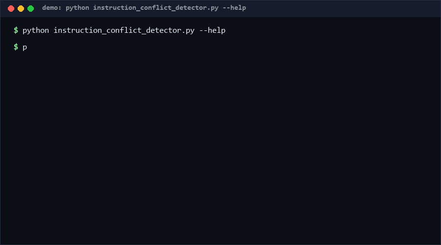

# instruction-conflict-detector

A stdlib-only, offline auditor that reads a system prompt as plain text and flags internal contradictions: positive/negative rule conflicts on the same subject, duplicated rules, undeclared priority between rules sharing a subject, and circular override chains ("Rule 1 overrides Rule 2 ..."). Zero network, zero model calls — if you merge prompt fragments from multiple authors, use this; otherwise skip it.

<p align="center"></p>

## Problem

System prompts accrete. Ten authors add rules; "Always answer in English" survives next to "Never answer in English", two rules fight for the same behavior with no declared winner, and an override chain quietly becomes a cycle. Models resolve these arbitrarily at runtime. A static, deterministic text audit catches the contradictions before deployment.

## How it works

- Parses numbered (`1.`, `1)`) or bulleted (`-`, `*`) lines as rules; each rule gets an explicit number when numbered.
- Modality detection: negative markers (never / not / don't / avoid / ...) beat positive markers (always / must / ensure / ...); neither -> neutral.
- Direct conflicts: a positive and a negative rule sharing >= 1 content keyword -> ERROR `DIRECT_CONFLICT`.
- Duplicates: identical normalized rule text -> WARN `DUPLICATE_RULE`.
- Undeclared priority: two rules sharing >= `--min-shared` (default 2) keywords with no priority marker (precedence / overrides / wins / ...) in either -> INFO `UNDECLARED_PRIORITY`.
- Override graph: "Rule N overrides/takes precedence over/precedes Rule M" statements build a directed graph; unknown rule references and cycles (including self-loops) are reported; cycles are ERROR `CIRCULAR_OVERRIDE`.
- Keyword extraction is Unicode-safe (`[^\W\d_]{3,}`), so non-ASCII prompts parse and analyze without crashing.

## Quickstart (~2 min)

```bash
python instruction_conflict_detector.py analyze prompt.txt                 # ~0.5s
python instruction_conflict_detector.py analyze prompt.txt --json          # CI-friendly output
python instruction_conflict_detector.py analyze prompt.txt --min-shared 3  # stricter priority warnings
```

Then run the self-test suite: `python self_test.py` (~3.4s; dominated by stress cases).

## Why not X

No direct equivalent found as of 2026-10-13: searches for "system prompt contradiction checker / instruction conflict detector" surface general prompt-evaluation frameworks, not standalone offline text-rule analyzers. Nearest neighbors:

- **LLM-as-judge prompt reviews** — probabilistic, costs tokens, needs network and a model; findings are not reproducible line-level facts. This repo is deterministic and free.
- **Prompt-management platforms (LangSmith, PromptLayer)** — version and diff prompts; none ship an internal-consistency conflict audit.
- **General linters (Vale, write-good)** — prose quality; no rule-pair semantics (modality, shared subject, override graphs).
- **Formal rule engines (drools-style)** — require rules already encoded in a structured language; this tool meets prompts where they are: plain text.

## Performance

Measured on CPython 3.13.12, Windows 10 Pro, 2026-10-13:

- Full self-test suite (64 cases): **~3.4 s** [Measured] — repro: `python self_test.py` (dominated by two intentional O(n^2) stress cases).
- Analyze a 300-rule prompt: **~407 ms/op** [Measured] — repro:

```bash
python -m timeit -s "import instruction_conflict_detector as m; t=open('prompt.txt', encoding='utf-8').read()" "m.analyze_rules(t)"
```

Pair analysis is O(rules^2); see Limits for the scaling boundary.

## Minimal Fallback

No installs needed beyond Python 3.8+. If you cannot run the analyzer:

```bash
grep -inE "always|must" prompt.txt   # positive rules
grep -inE "never|do not|don't" prompt.txt   # negative rules — eyeball for same-subject pairs
grep -inE "overrides|precedence" prompt.txt # override chains — check for cycles by hand
```

You lose keyword matching, cycle detection, and the exit-code contract.

## Design Trade-offs

- **Lexical heuristics over semantics**: shared keywords approximate "same subject"; zero dependencies and fully explainable findings, accepting false positives/negatives that a human reviewer resolves.
- **Negative modality dominance**: "Never use X" stays negative even when it also contains "use"; ambiguity resolves toward flagging.
- **Priority order**: conflict detection (hard errors) > override-graph integrity > priority hygiene (info) > convenience.

## Limits & Second-order Effects

- English modality markers only; non-English prompts parse (Unicode-safe) but conflict detection degrades to duplicate/override checks. Chinese negation (不/禁止) is not detected — a deliberate v0 scope cut.
- O(rules^2) pair analysis: fine to ~1,000 rules (sub-minute), slow beyond; the self-test stresses 2,000 rules once to document this honestly.
- Widely adopted, prompt authors may rephrase contradictions with synonyms to evade shared-keyword matching — findings are review prompts, not proof of consistency. Teams may also add empty "overrides" statements to silence priority infos, polluting the override graph.

## FAQ

**Does it call an LLM or any network service?** No — pure stdlib regex text analysis, fully offline and deterministic. That is its defensive positioning.

**Why did two rules sharing one keyword not warn?** Priority warnings require `--min-shared` matches (default 2) to reduce noise; direct conflicts need only one.

**When NOT to use this tool?** Skip it for short prompts you wrote yourself in one sitting (few rules, low contradiction risk, review is trivial). And never treat a clean report as proof of semantic consistency — synonym-phrased contradictions pass by design.

## [Core Assumptions]

1. System prompts can be treated as lists of discrete rules expressed in numbered/bulleted lines.
2. Modality markers (always/never/must/not) are lexical and detectable by regex in English.
3. Shared content keywords approximate "same subject" well enough to be useful.
4. Explicit override statements ("Rule N overrides Rule M") are the dominant priority mechanism worth graph-checking.

---

Confidence: High (≥80%) for parsing, duplicate, and override-cycle behavior — 64 self-test cases including 4-node cycles and 500-duplicate stress. Medium (60-79%) for conflict-detection recall on natural prompts — lexical heuristics are honest but incomplete. Data as of 2026-10-13.

---

Part of the [zhengming-toolbox](https://github.com/chenhz01/zhengming-toolbox) — 105 purpose-built AI-engineering tools across neglected niches.

Related tools: [llm-error-code-spec](https://github.com/chenhz01/llm-error-code-spec) · [context-truncation-bench](https://github.com/chenhz01/context-truncation-bench) · [adr-staleness-check](https://github.com/chenhz01/adr-staleness-check)
